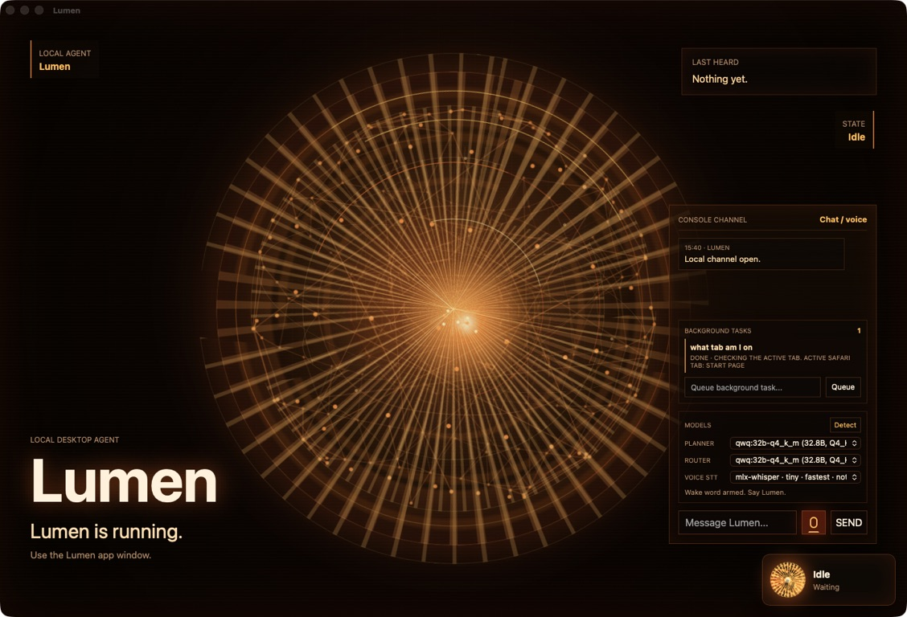

<h1 align="center">Lumen</h1>

[Portfolio case study](https://ompatnaik.com/projects/lumen/) · [Project & installation site](https://lumen.ompatnaik.com/)

**Run a desktop agent on your Mac with local model discovery, optional voice, and approval prompts for tool actions.**

[Demo or published artifacts](https://lumen.ompatnaik.com)

Experimental Apple Silicon macOS app. Local inference provider required. Local backend; source builds are unsigned and unnotarized.

By Om Patnaik · repository created July 2026.

[](LICENSE)



## Install

| Platform / path | Start here |
| --- | --- |
| Homebrew | `brew tap OmTheLast/lumen https://github.com/OmTheLast/Lumen.git`, then `brew install lumen-local` |
| From source | `uv sync` (Python 3.11+) |

Start Ollama or LM Studio with a chat model, then run `lumen-app` or the source command below. Model weights are separate downloads. Try a low-impact command such as `open Safari` and inspect the tool flow before approving file or shell work.

```bash
uv run python -m lumen.main
```

## Why

You want local models to act on your desktop without changing tools for chat, voice, and task history. Lumen connects a local planner to macOS tools and a native window. It is an early prototype; approvals need your review and queued tasks are processed one at a time.

## Choose a local model

Lumen detects Ollama at port 11434 and LM Studio at port 1234. Select planner, router, and speech models in the interface; settings live in `~/.lumen/config.json`.

## Review actions and tasks

The approval queue shows tool arguments and reasons before gated actions. Background task state lives in `~/.lumen/tasks.json`; browser controls use macOS automation permissions.

## Notes from building it

I added model discovery instead of requiring one fixed model name. A native wrapper and shared orb state make the local backend visible outside Terminal. I would replace speech-recognition-based wake detection with a smaller dedicated wake-word model next.

## Commands

```bash
lumen-app                                      # open the Homebrew app
uv run python -m lumen.main                     # run from a checkout
uv sync --extra voice                           # install optional transcription support
scripts/build_macos_app.sh --install-user       # build the development app
uv run pytest                                  # run the Python tests
```

## Verify it yourself

```bash
uv run pytest
```

The repository’s Python tests exercise the implemented backend components. Native window behaviour, microphone permissions, AppleScript controls, and local-model responses require a Mac interaction check; these were not re-run by the README edit.

## Credits, license and pointers

Built with Python, macOS AppKit/AppleScript, Ollama or LM Studio, and optional MLX Whisper. [MIT](LICENSE).

[Full setup, original notes, and project history](README-DETAILS.md).
